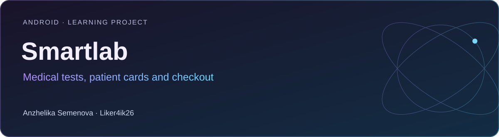

# Smartlab

**Android · Learning project** · Kotlin · Jetpack Compose · Retrofit · Moshi · Hilt · Paging

Учебное приложение медицинской лаборатории: каталог анализов, карточки пациентов, корзина и оформление заказа.

[Портфолио автора](https://portfolio.semenova-anzhelika.online/) · [Профиль GitHub](https://github.com/Liker4ik26) · [Исходники](https://github.com/Liker4ik26/smartlab/tree/develop)

> Развёрнутая реализация находится в develop. В master сохранена начальная заготовка; ниже приведён запуск develop.

## Что в проекте

- Онбординг, авторизация, проверка кода и экран пароля.
- Каталог анализов и подробная информация об исследовании.
- Карточки пациентов, выбор пациента и профиль.
- Корзина, оформление заказа, выбор адреса, даты и времени.

## Технологии

| Направление | Реализация |
| :--- | :--- |
| Стек | Kotlin · Jetpack Compose · Retrofit · Moshi · Hilt · Paging |
| Формат | Android · Learning project |
| Окружение | Android Studio; JDK, совместимый с Gradle; compileSdk 33; minSdk 24 |

## Как запустить

Требования: Android Studio; JDK, совместимый с Gradle; compileSdk 33; minSdk 24.

```bash
git clone --branch develop https://github.com/Liker4ik26/smartlab.git
cd smartlab
```

Откройте корень репозитория в Android Studio, выполните Gradle Sync и выберите Android-эмулятор или устройство. Для сборки из терминала:

```bash
bash gradlew :app:assembleDebug
```

## English overview

**Smartlab — Medical tests, patient cards and checkout.**

Android · Learning project. Stack: Kotlin · Jetpack Compose · Retrofit · Moshi · Hilt · Paging. The full application source is in the `develop` branch. [Explore my professional portfolio](https://portfolio.semenova-anzhelika.online/).

---

**Автор — Анжелика Семёнова · [Liker4ik26](https://github.com/Liker4ik26)**

[Сайт](https://portfolio.semenova-anzhelika.online/) · [Telegram](https://t.me/Liker4ik50) · [Почта](mailto:pr110oat18@gmail.com)
